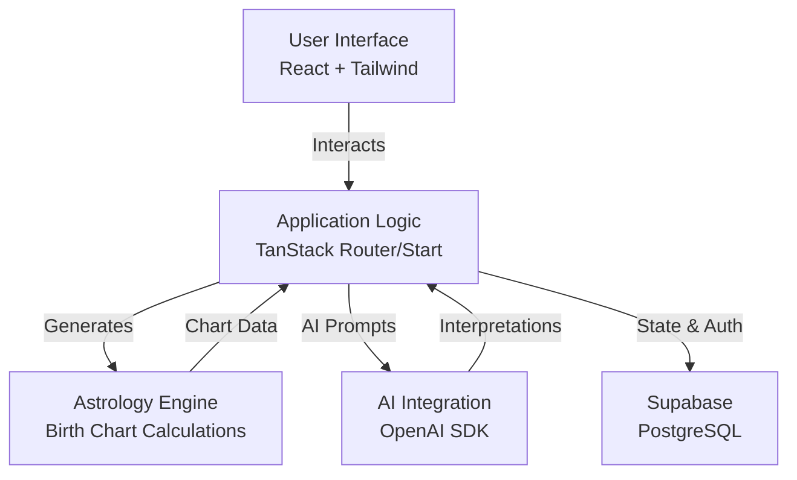
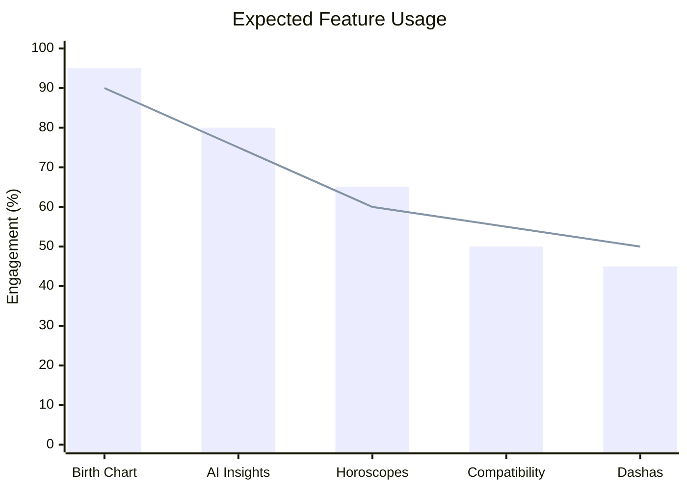

# 🌌 Celestial Narrative AI (AstroVeda)

> "Discover the patterns written in your stars."


AstroVeda is a premium, beautifully designed full-stack astrology web application. It combines Vedic astrology calculations, an AI-powered interpretation system, an elegant visual experience, and a scalable architecture to provide profound insights into your celestial blueprint.

---

## ✨ Features

- **Astrological Charts**: Generate precise birth charts (Kundli) using Vedic astrology principles.
- **AI-Powered Insights**: Get answers to life's profound questions regarding career, relationships, and personal growth using advanced AI models.
- **Premium UI/UX**: Immerse yourself in a cosmic theme with smooth animations, dark indigo aesthetics, and a glassmorphic interface.
- **Dasha System**: Explore your Vimshottari Mahadasha and Antardasha periods.
- **Secure Authentication**: Robust user management and secure profile storage via Supabase.

---

## 🏗️ System Architecture



---

## 📊 Application Usage Overview



---

## 🛠️ Technology Stack

| Category        | Technology                                                                 |
|-----------------|----------------------------------------------------------------------------|
| **Frontend**    | React 19, TypeScript, Vite, Tailwind CSS 4, Framer Motion, Radix UI        |
| **Routing**     | TanStack Router & Start                                                    |
| **Backend/DB**  | Node.js, Supabase (PostgreSQL), Edge Functions                             |
| **AI Layer**    | Vercel AI SDK, OpenAI API                                                  |
| **Deployment**  | Vercel / Netlify (Recommended)                                             |

---

## 🚀 Getting Started

### Prerequisites
- Node.js (v18+)
- npm, yarn, pnpm, or bun

### Installation

1. **Clone the repository**
   ```bash
   git clone https://github.com/dakshpadaye13/celestial-narrative-ai.git
   cd celestial-narrative-ai
   ```

2. **Install dependencies**
   ```bash
   npm install
   ```

3. **Environment Setup**
   Create a `.env` file in the root directory and add your keys:
   ```env
   VITE_SUPABASE_URL=your_supabase_url
   VITE_SUPABASE_ANON_KEY=your_supabase_anon_key
   OPENAI_API_KEY=your_openai_api_key
   ```

4. **Run the development server**
   ```bash
   npm run dev
   ```

5. **Open your browser**
   Navigate to `http://localhost:5173` to explore the cosmos.

---

## 🤝 Contributing

Contributions are welcome! Please feel free to submit a Pull Request.

1. Fork the project
2. Create your feature branch (`git checkout -b feature/AmazingFeature`)
3. Commit your changes (`git commit -m 'Add some AmazingFeature'`)
4. Push to the branch (`git push origin feature/AmazingFeature`)
5. Open a Pull Request

---

## 📜 License

This project is licensed under the MIT License - see the LICENSE file for details.

---

<p align="center">
  <i>May the stars guide your journey.</i>
</p>
